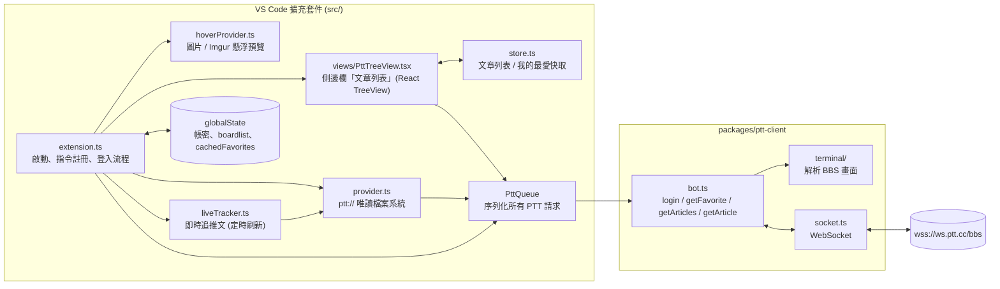
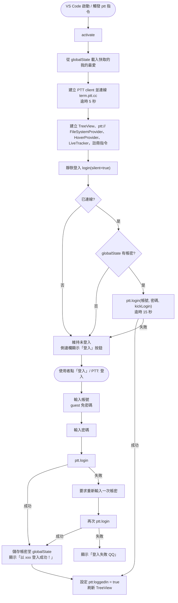

# vscode-ptt 流程圖與使用方式

## 一、整體架構



## 二、啟動與登入流程



## 三、瀏覽看板與文章


## 四、即時追推文 (Live Tracking)

```mermaid
flowchart TD
  A([文章分頁右上角 📡 / 右鍵 / 狀態列]) --> B{目前是 ptt:// 文章?}
  B -- 否 --> W[提示：請先開啟 PTT 文章]
  B -- 是 --> C{已登入?}
  C -- 否 --> W2[提示：請先登入]
  C -- 是 --> D[建立 session<br/>每 liveTrackingInterval 秒 (預設 3) 執行]
  D --> E[refreshArticle：重新 getArticle]
  E --> F{內容有變?}
  F -- 是 --> G[觸發 onDidChangeFile → 編輯器更新<br/>liveTrackingAutoScroll 時捲到底]
  F -- 否 --> D
  G --> D
  D -.-> H([停止：再按一次 ⏹ / 關閉分頁 / 斷線 / 登出])
```

## 五、使用方式

### 安裝

1. 在 VS Code 擴充功能市集搜尋 **「VSCode 批踢踢」**（`Yukai.vscode-ptt`）安裝，或：
   ```bash
   code --install-extension Yukai.vscode-ptt
   ```
2. 左側活動列出現 PTT 圖示，點開即為「文章列表」。

### 基本操作

| 想做的事 | 操作方式 |
| --- | --- |
| 登入 | 側邊欄「登入」按鈕，或指令面板 `PTT: 登入`。帳號輸入 `guest` 可免密碼。帳密會記住，下次啟動自動登入 |
| 訂閱看板 | 側邊欄標題列 `＋`，輸入看板名稱（如 `C_Chat`、`Gossiping`） |
| 從我的最愛訂閱 | 「我的最愛」會自動列出你 PTT 帳號的最愛看板；也可用指令 `ptt.favorite-board` 挑選加入「其他看板」 |
| 看文章 | 展開看板 → 點文章標題，於編輯器以唯讀方式開啟 |
| 載入更舊文章 | 看板底部「載入更多文章」 |
| 以推文數篩選 | 看板右鍵 → 「以推文數搜尋」，輸入 0~100 |
| 重新整理 | 看板右側 🔄 重新整理該看板；標題列 🔄 重新整理看板列表與我的最愛（同時清除推文數篩選） |
| 移除看板 | 看板右鍵 → 「移除訂閱看板」 |
| 即時追推文 | 開啟文章後按編輯器右上角 📡（或 `PTT: 切換即時追推文`），再按 ⏹ 停止 |
| 圖片預覽 | 滑鼠停在文章中的 imgur / 圖片網址上 |
| 登出 | 標題列登出按鈕（會一併清除帳密與訂閱看板） |

### 設定 (settings.json)

| 設定 | 預設 | 說明 |
| --- | --- | --- |
| `kickLogin` | `false` | 登入時踢掉其他重複登入 |
| `previewImages` | `true` | 懸浮提示中預覽圖片 |
| `previewImageWidth` | `320` | 預覽寬度（px，0 為不限制） |
| `liveTrackingInterval` | `3` | 即時追推文刷新秒數（1~60） |
| `liveTrackingAutoScroll` | `true` | 追推文時自動捲到底 |

### 開發

需要 Node.js 與 pnpm（見 `mise.toml`）。

```bash
pnpm install
```

```bash
pnpm build        # 打包 ptt-client 與擴充套件到 out/extension.js
```

```bash
pnpm test         # 編譯 + 單元測試 + ptt-client 測試
```

```bash
pnpm package      # 產生 .vsix
```

在 VS Code 開啟專案後按 F5 選 **Run Extension**，會開新視窗載入開發中的擴充套件。整合測試帳密可參考 `.env.example`。
