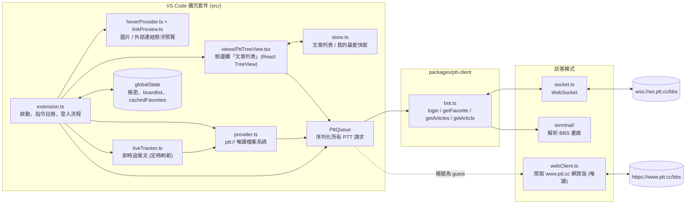
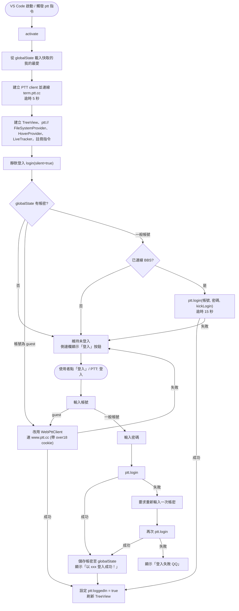
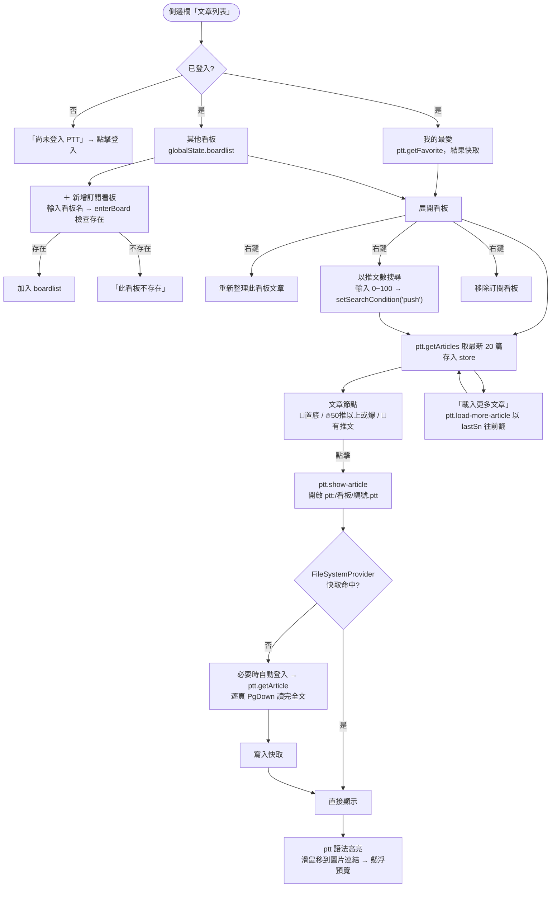

# vscode-ptt 流程圖與使用方式

## 一、整體架構



## 二、啟動與登入流程



## 三、瀏覽看板與文章



## 四、即時追推文 (Live Tracking)

```mermaid
flowchart TD
  A([文章分頁右上角 📡 / 右鍵 / 狀態列]) --> B{目前是 ptt:// 文章?}
  B -- 否 --> W[提示：請先開啟 PTT 文章]
  B -- 是 --> C{已登入?}
  C -- 否 --> W2[提示：請先登入]
  C -- 是 --> D[建立 session<br/>每 liveTrackingInterval 秒 (預設 3) 執行]
  D --> E[refreshArticle：重新 getArticle]
  E --> F{內容有變?}
  F -- 是 --> G[觸發 onDidChangeFile → 編輯器更新<br/>liveTrackingAutoScroll 時捲到底]
  F -- 否 --> D
  G --> D
  D -.-> H([停止：再按一次 ⏹ / 關閉分頁 / 斷線 / 登出])
```

## 五、使用方式

### 安裝（從自己的 Fork 打包 .vsix）

需要 Node.js 20+、pnpm 與 VS Code 的 `code` 指令。

```bash
git clone https://github.com/<你的帳號>/vscode-ptt.git
```

```bash
cd vscode-ptt
```

```bash
pnpm install
```

```bash
pnpm package
```

會在專案根目錄產生 `vscode-ptt-<版本>.vsix`，接著安裝：

```bash
code --install-extension vscode-ptt-0.4.1.vsix --force
```

這個 Fork 的擴充功能 ID 是 `kalpy.vscode-ptt`（原版為 `Yukai.vscode-ptt`），兩者可以同時存在，市集的自動更新也不會覆蓋它。建議先在擴充功能面板停用或解除安裝原版，免得兩個側邊欄同時出現。

也可以在 VS Code 擴充功能面板右上角 `⋯` → **從 VSIX 安裝…** 選這個檔案。安裝後重新載入視窗，左側活動列會出現 PTT 圖示。

注意事項：

- `package.json` 指定的是 `pnpm@12`。如果你的 pnpm 版本切換失敗，可以用 `mise install` 裝指定版本，或在 `~/.npmrc` 加上 `manage-package-manager-versions=false`，改用本機的 pnpm 10。
- 改完程式碼後重新執行 `pnpm package`，再用同一行 `code --install-extension ... --force` 覆蓋安裝即可。

### 部署

#### A. 安裝到自己的 VS Code（最常用）

在專案根目錄執行。這行會打包成 `vscode-ptt.vsix` 並直接覆蓋安裝；改完程式碼後重跑同一行即可：

```bash
pnpm install
```

```bash
pnpm run install:local
```

完成後在 VS Code 執行「Developer: Reload Window」。

#### B. 發佈 GitHub Release（給其他電腦或朋友安裝）

先把 `package.json` 的 `version` 改成新版本並 commit，再打同版本號的 tag 推上去：

```bash
git tag v0.4.2
```

```bash
git push origin v0.4.2
```

GitHub Actions 的 `Publish Extension` 會跑 lint、測試、打包，並把 `vscode-ptt.vsix` 掛到同名 Release。其他電腦下載後執行：

```bash
code --install-extension vscode-ptt.vsix --force
```

想先確認能不能打包、但不發佈，可以在 GitHub 的 Actions 頁面手動執行 `Publish Extension`，勾選 `dry_run`。

#### C. 發佈到市集（選用）

需要先在 Visual Studio Marketplace 建立名為 `kalpy` 的 publisher，並在 repo 的 Settings → Secrets 設定 `VSCE_PAT`（Open VSX 則是 `OVSX_PAT`）。沒有設定的話，workflow 會跳過市集發佈，只建立 GitHub Release。

### 基本操作

| 想做的事 | 操作方式 |
| --- | --- |
| 登入 | 側邊欄「登入」按鈕，或指令面板 `PTT: 登入`。帳密會記住，下次啟動自動登入 |
| 訪客模式 | 帳號輸入 `guest`（不用密碼）。PTT 的 BBS 介面拒絕 guest，所以這個模式改為讀取網頁版 www.ptt.cc：可以瀏覽看板與文章、以推文數搜尋、即時追推文；「我的最愛」會改顯示熱門看板。只能看、不能推文或發文，網頁版沒有的看板也看不到 |
| 訂閱看板 | 側邊欄標題列 `＋`，輸入看板名稱（如 `C_Chat`、`Gossiping`） |
| 從我的最愛訂閱 | 「我的最愛」會自動列出你 PTT 帳號的最愛看板；也可用指令 `ptt.favorite-board` 挑選加入「其他看板」 |
| 看文章 | 展開看板 → 點文章標題，於編輯器以唯讀方式開啟 |
| 載入更舊文章 | 看板底部「載入更多文章」 |
| 以推文數篩選 | 看板右鍵 → 「以推文數搜尋」，輸入 0~100 |
| 重新整理 | 看板右側 🔄 重新整理該看板；標題列 🔄 重新整理看板列表與我的最愛（同時清除推文數篩選） |
| 移除看板 | 看板右鍵 → 「移除訂閱看板」 |
| 即時追推文 | 開啟文章後按編輯器右上角 📡（或 `PTT: 切換即時追推文`），再按 ⏹ 停止 |
| 圖片與連結預覽 | 滑鼠停在文章中的網址上：圖片網址直接顯示圖片；其他連結顯示網頁的縮圖、標題與摘要（YouTube 顯示影片縮圖） |
| 登出 | 標題列登出按鈕（會一併清除帳密與訂閱看板） |

### 設定 (settings.json)

| 設定 | 預設 | 說明 |
| --- | --- | --- |
| `kickLogin` | `false` | 登入時踢掉其他重複登入 |
| `previewImages` | `true` | 懸浮提示中預覽圖片 |
| `previewLinks` | `true` | 懸浮預覽外部連結的縮圖、標題與摘要 |
| `previewImageWidth` | `320` | 預覽寬度（px，0 為不限制） |
| `liveTrackingInterval` | `3` | 即時追推文刷新秒數（1~60） |
| `liveTrackingAutoScroll` | `true` | 追推文時自動捲到底 |

### 開發

需要 Node.js 與 pnpm（見 `mise.toml`）。

```bash
pnpm install
```

```bash
pnpm build        # 打包 ptt-client 與擴充套件到 out/extension.js
```

```bash
pnpm test         # 編譯 + 單元測試 + ptt-client 測試
```

```bash
pnpm package      # 產生 .vsix
```

在 VS Code 開啟專案後按 F5 選 **Run Extension**，會開新視窗載入開發中的擴充套件。整合測試帳密可參考 `.env.example`。
